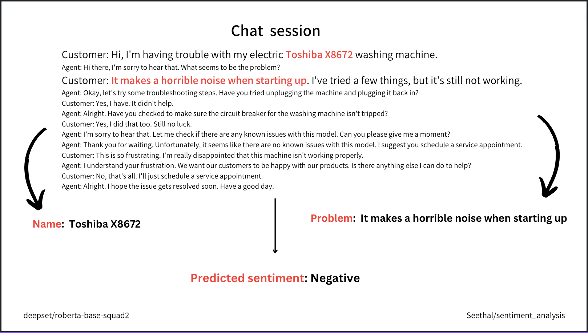
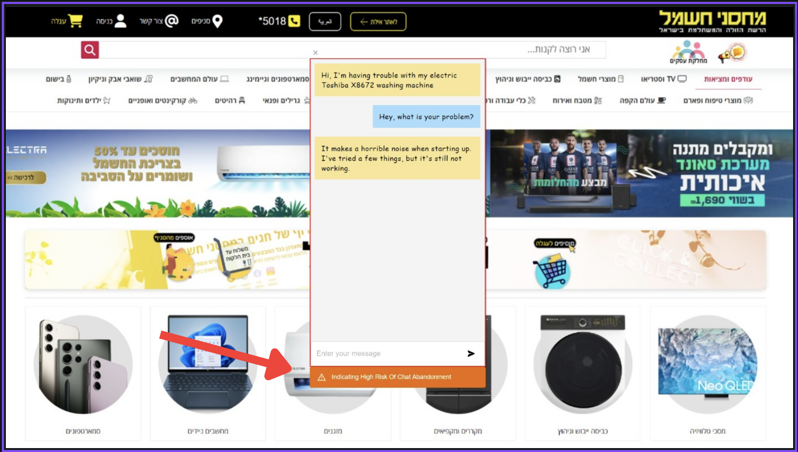
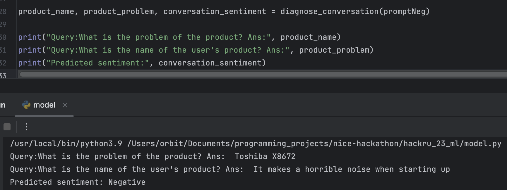
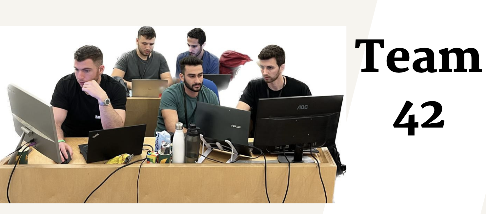

# Churn-Risk Alerts for Customer Support Chats (HackRU 2023, NICE challenge)

Customers are most likely to leave when they call about a problem that support has already failed to fix for other people. Built at the HackRU 2023 hackathon at Reichman University for NICE's customer-support challenge, this project reads a live support chat, pulls out *which product* and *which problem* the customer is describing, and checks a history of past chats for how often that product and problem combination ended unresolved. When the odds are bad, the agent (or bot) gets a real-time "high risk of chat abandonment" alert and can escalate to a specialist or a human before the customer gives up. Extraction uses a RoBERTa question-answering model (`deepset/roberta-base-squad2`), and resolution is judged by running sentiment analysis on the customer's last lines of each past chat.

**Key result:** a working end-to-end prototype. From a raw transcript, the pipeline extracts the product ("Toshiba X8672"), the problem ("It makes a horrible noise when starting up") and the outcome sentiment ("Negative") with no task-specific training, and the demo chat widget raises the risk alert live. This was a hackathon prototype, so there is no benchmark accuracy to report.



---

## How it works

**Building the history (offline)**
1. Take past support conversations, with each line tagged by speaker.
2. Ask the QA model two questions about each chat: "What is the name of the user's product?" and "What is the problem of the product?"
3. Classify the sentiment of the customer's last lines. A negative ending is treated as an unresolved problem.
4. Store `product → problem → % resolved`.

**During a live chat**
1. Run the same extraction on the conversation so far.
2. Look up the product and problem. If it is statistically unresolved, alert the agent.
3. When the chat ends, update the history with the new outcome.

## Demo





## What's in this repository

`model.py` holds the NLP core: `query_conversation` (RoBERTa extractive QA), `predict_sentiment` (sentiment on the customer's last 7 lines, using `Seethal/sentiment_analysis_generic_dataset`) and `diagnose_conversation`, plus three sample conversations. The chat front end and back end shown in the demo are not in this repository.

```sh
pip install transformers torch
python model.py
```

Assumption: transcripts are tagged by speaker (`Agent:` / `Customer:`) and record which side ended the chat.

## Team

Ronny Baturov, Omri Gal Shenhav, Lior Alon, Or Virt



Thanks to Reichman University and NICE for running the challenge, and to the NICE product managers who explained where the current support flow breaks down.
